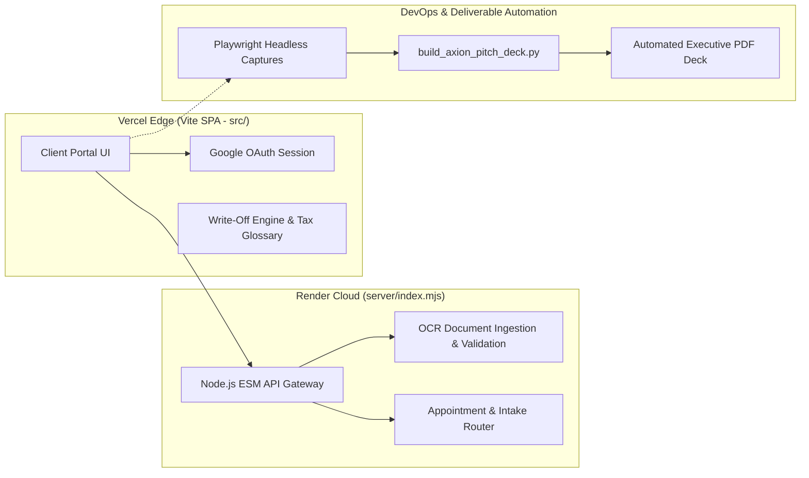

# Axion Tax & Beyond — Intelligent B2B Tax Intake & OCR Client Portal

> **Live Production Frontend:** [https://axion-tax-beyond.vercel.app](https://axion-tax-beyond.vercel.app)  
> **Architecture:** Decoupled Vite SPA (`src/`) + Node.js/ESM Backend API (`server/index.mjs`) + Playwright/Python Artifact Pipeline  

## 1. Executive Summary & Problem Statement
Independent tax and accounting agencies lose hundreds of billable hours every tax season to fragmented paper document drop-offs, incomplete W-2/1099 submissions, and repetitive deduction inquiries. 

**Axion Tax & Beyond** replaces manual paper intake with a full-stack digital client portal featuring **OCR document ingestion**, **Google OAuth authentication**, **guided write-off discovery**, and **automated consultation scheduling**.

---

## 2. System Architecture & Infrastructure Topology



---

## 3. Key Engineering Decisions & Production Highlights

### Decoupled Cloud Deployment (`Vercel` + `render.yaml`)
* **Frontend Edge Delivery:** Built with **Vite (`vite.config.js`)** and deployed to **Vercel** (`axion-tax-beyond.vercel.app`) for sub-second static asset delivery and responsive mobile document capture.
* **Backend ESM Service:** Isolated stateful API routes, OCR processing, and intake orchestration inside a dedicated **Node.js ECMAScript Module (`server/index.mjs`)** declaratively provisioned via **`render.yaml`**.

### Intelligent Document Processing (OCR Upload Pipeline)
* Designed a structured document upload flow allowing clients to photograph or upload tax forms directly from mobile or desktop devices.
* Implemented pre-submission validation and categorization so tax preparers receive normalized digital packets rather than raw, unindexed attachments.

### Self-Service Domain Engines (Write-Off Discovery & Glossary)
* Built interactive client-side tools that guide filers through eligible business and personal deductions before their consultation, shrinking average intake review cycles.

### Programmatic Visual QA & Artifact Generation (`Playwright` + `Python`)
* Engineered an automated browser verification workflow that launches the portal, captures deterministic full-bleed UI states across key user journeys into `output/playwright/`, and executes **`build_axion_pitch_deck.py`** to compile **`axion-owner-pitch-deck.pdf`** without manual slide design.

---

## 4. Repository Structure

```text
axion-tax/
├── src/                        # Vite frontend application, OCR uploader, write-off & glossary modules
├── server/
│   └── index.mjs               # Node.js ESM backend API & document intake router
├── output/
│   ├── playwright/             # Automated headless browser UI state captures
│   └── pdf/                    # Programmatically generated stakeholder PDF deck
├── build_axion_pitch_deck.py   # Python automation script compiling Playwright captures into PDF
├── render.yaml                 # Infrastructure-as-Code blueprint for backend API deployment
├── vite.config.js              # Vite bundler & local proxy configuration
└── package.json                # Project dependencies & build scripts
```

---

## 5. Local Development & Verification

```bash
# 1. Install dependencies
npm install

# 2. Launch local development server (runs at http://127.0.0.1:5174)
npm run dev

# 3. Verify production bundle
npm run build

# 4. Regenerate executive PDF deck from Playwright captures
python3 build_axion_pitch_deck.py
```
